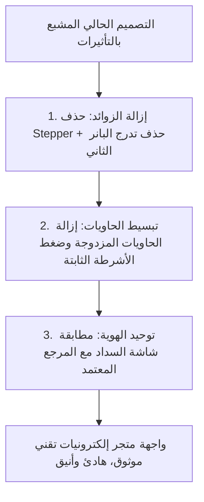

# تقرير إعادة التقييم البصري والتشخيص الشامل — متجر ويكس تكنولوجي (Wex Technology)

**تاريخ التقرير:** 21 نوفمبر 2026  
**الهدف:** فحص بصري مبني على الأدلة للواجهات الفعلية، مقارنة التنفيذ الحالي بالمرجع المعتمد وهندسة الهوية، وفرز التحسينات الوظيفية عن التراكم التجميلي، مع تقديم خطة تصحيحية دقيقة بدون تعديل للكود أو الالتزام بأي commit قبل الاعتماد.  
**حالة العمل:** التدرج البرمجي متوقف بالكامل (Stop progression). المرحلة الرابعة لم تبدأ.

---

## 1. الملخص التنفيذي (Executive Summary)

أثبتت المراجعة البصرية الدقيقة للشاشات الفعلية على الهواتف الذكية (360px و 390px) صحة التشخيص النقدي: **تراكم التأثيرات البصرية والانتقالات والظلال والتدرجات اللونية لم يحسن تجربة الاستخدام، بل راكم ضجيجاً بصرياً خصم من هدوء ورصانة المتجر كمتجر إلكترونيات تقني موثوق في أم درمان.**

### جوهر المشكلة الحالية:
1. **تزاحم العناصر الزخرفية:** تحولت بعض الشاشات إلى استعراض لعناصر CSS (تدرجات مائلة، أشرطة متقاطعة، ظلال زرقاء متعددة المستويات، حلقات توهج، مؤثرات زجاجية `backdrop-filter: blur(16px)`، وتقليص أحجام الأزرار عند النقر `scale(0.97)` في كل مكان)، مما أفقد الصفحة الهرمية البصرية الواضحة.
2. **ابتلاع المساحة الرأسية على الشاشات الصغيرة (360px):** أصبحت الأشرطة السفلية الثابتة (Sticky Bars) بالإضافة إلى شرائط الهيدر وحاويات الملخص تبتلع أكثر من 25% من المساحة الرأسية للشاشة، مما يضطر المستخدم في شاشة مثل "تأكيد الطلب" أو "تفاصيل الجهاز" للتمرير الطويل قبل الوصول للمعلومات الأساسية.
3. **وهم المراحل الإجرائية (Process Illusion):** إقحام شريط مراحل من 3 خطوات (`stepperRow`) في شاشة تأكيد الطلب، في حين أن عملية الشراء في ويكس مصممة بنموذج أحادي سريع ومباشر (Single-page purchase).
4. **تعدد اللغات البصرية في شاشة واحدة:** كما في شاشة الدفع، حيث تجتمع بطاقة داكنة متدرجة للمستقبل، مع بطاقة بيضاء تقليدية للحسابات البنكية، مع صندوق رفع إشعار متقطع الحواف، مع خط زمني لنقاط الحالة.

---

## 2. فحص الشاشات الفعلية والمقارنة مع المرجع المعتمد (Screen-by-Screen Reference Comparison)

### 2.1. الصفحة الرئيسية (Home Screen)

````carousel

<!-- slide -->

<!-- slide -->

````

| المعيار | المرجع المعتمد (`wex-mockup`) | التنفيذ الحالي (`HomePage.jsx`) | التقييم والانحراف البصري |
| :--- | :--- | :--- | :--- |
| **التدرجات والهيرو** | بانر خصم مائل واحد فقط (`app-discount-banner`) يجمع الرسالة الترويجية وتثبيت السعر. | **بطاقتان متدرجتان متطابقتان تماماً** (`.heroCard` و `.appDiscountBanner`) تفصل بينهما أيقونات التصنيفات! | **انحراف حرج:** تصادم تدرجي مزدوج يملأ الشاشة بلون أزرق ساطع خانق ويخلق تشويشاً بصرياً للمستخدم. |
| **نقطة تحديث السعر** | شريحة أنيقة في الترويسة ("الدرهم اليوم: 650 جنيه") مع نقطة نبضية هادئة. | وميض cyan ساطع مع نص مفرغ في مساحة مستقلة أسفل البحث. | مقبولة ولكن بحاجة لدمج أنظف بجوار الترحيب لتوفير مساحة رأسية. |
| **فقاعات التصنيفات** | دوائر بيضاء نظيفة بأيقونات رمادية واضحة وأسماء أقسام مباشرة. | بطاقات خارجية بيضاء + حاويات squircle جليدية داخلية (حاوية داخل حاوية). | تعقيد زخرفي غير مبرر يقلل المساحة المخصصة للنصوص على عرض 360px. |
| **بطاقات الأجهزة** | بطاقة بيضاء بحد جليدي ناعم، بادج حالة، رسمة لابتوب SVG، مواصفات خفيفة وسعر بالجنيه. | كروت مزدحمة: بادج حالة + قلب مفضلة + تدرج جليدي داخلي + شريحة مواصفات + زر إضافة. | ازدحام شديد يسبب التفاف الأسطر على عرض 360px. |

---

### 2.2. شاشة المعرض والتصفية (Catalog Screen)

````carousel

<!-- slide -->

````

| المعيار | المرجع المعتمد | التنفيذ الحالي (`CatalogPage.jsx`) | التقييم والانحراف البصري |
| :--- | :--- | :--- | :--- |
| **شريط البحث والتصفية** | حقل بحث مرن + شريط شرائح أفقي واحد + زر التصفية. | حقل بحث بارتفاع 48px + شريط شرائح مع أزرار تصفية بأحجام متفاوتة. | جيد وظيفياً، لكن على قياس 360px تلتف الشرائح بشكل غير متناسق. |
| **شبكة المنتجات (2 Columns)** | فراغ ناعم 10-12px بين البطاقات وبطاقات ذات محاذاة أفقية مستقرة. | بطاقات معقدة بحواف `16px`، تدرجات خلفية بيضاء-جليدية للصور، وأزرار "+ أضف" في الأسفل. | عرض العمود في شاشة 360px هو **156px فقط**، مما يضغط السعر واسم الماركة إلى حافة البطاقة. |
| **الهيدر والترويسة** | عنوان واحد مدمج مع عداد الأجهزة في الـ AppBar. | تم إخفاء الـ `header` على الشاشات الصغيرة لتفادي الازدواجية (قرار ممتاز). | تحسين سليم مثبت يجب الحفاظ عليه. |

---

### 2.3. تفاصيل الجهاز (Product Details Screen)

````carousel

<!-- slide -->

````

| المعيار | المرجع المعتمد | التنفيذ الحالي (`ProductDetailPage.jsx`) | التقييم والانحراف البصري |
| :--- | :--- | :--- | :--- |
| **حاوية الصورة** | مساحة مريحة للصورة مع بادج الحالة والماركة بدون أزرار طافية معقدة. | صورة في نسبة 4:3 داخل بطاقة خارجية بيضاء + زر تكبير في الأسفل + زر مفضلة طافٍ في الأعلى. | ازدحام الأزرار الطافية فوق صورة الجهاز يشوش على الرؤية الفاحصة للابتوب. |
| **كتلة السعر والملاحظة** | شريط مائل خفيف (`wex-ribbon-subtle`) بخط أرقام عريض 24px وملاحظة واضحة. | كرت منفصل بحدود علوية وسفلية، وسطر لتثبيت السعر أسفل القيمة. | التوزيع جيد ولكن الخطوط الفاصلة مفرطة وتخلق تقطيعاً بصرياً في الصفحة. |
| **التبويبات والمواصفات** | جدول مواصفات متصل وهادئ يظهر المعالج والرام والتخزين والكرت والشاشة. | تبويبات مقسمة (Segmented Control) داخل بطاقة خاصة وظلال. | التبويب ممتاز، لكن الخطوط الفاصلة بين المواصفات باهتة ولا تستغل المساحة الأفقية. |
| **الشريط السفلي الثابت** | زر شراء عريض هادئ ("اطلب الآن"). | شريط سفلي بارتفاع 74-96px يحتوي على عداد كمية ضخم (Stepper) + زر أضف للسلة. | العداد يستهلك ثلث الشريط السفلي بلا مبرر، إذ أن 95% من طلبات اللابتوبات تكون لجهاز واحد. |

---

### 2.4. سلة المشتريات (Cart Screen)

````carousel

<!-- slide -->

````

| المعيار | المرجع المعتمد | التنفيذ الحالي (`CartPage.jsx`) | التقييم والانحراف البصري |
| :--- | :--- | :--- | :--- |
| **بطاقة الجهاز في السلة** | صورة مصغرة، اسم الجهاز، المواصفات، وسعر السطر. | صورة مصغرة + اسم ورابط + زر حذف سلة + عداد كمية + إجمالي السطر. | التوزيع متوازن، وزر التراجع في التوست (Undo) يمثل قيمة مضافة حقيقية. |
| **بطاقة الملخص المالي** | المجموع، الخصم 3%، الإجمالي النهائي بخط عريض 800. | بطاقة بيضاء مستقلة تحتوي نفس الأسطر وتكرر الإجمالي. | جيد ومقروء، مع الحفاظ على قاعدة عدم تسريب أسعار الصرف. |
| **الشريط السفلي الثابت** | زر متابعة الطلب مع كتابة المبلغ الإجمالي داخل الزر. | شريط سفلي بضبابية 16px وزر عريض بإجمالي المبلغ. | سليم وواضح وسهل الوصول بإبهام اليد. |

---

### 2.5. شاشة تأكيد الطلب (Checkout Screen)

````carousel

<!-- slide -->

<!-- slide -->

````

| المعيار | المرجع المعتمد | التنفيذ الحالي (`CheckoutPage.jsx`) | التقييم والانحراف البصري |
| :--- | :--- | :--- | :--- |
| **شريط الخطوات (Stepper)** | **لا يوجد إطلاقاً.** النموذج عبارة عن صفحة واحدة واضحة ومباشرة. | **شريط خطوات من 3 مراحل (`1 الاستلام` ← `2 التواصل` ← `3 المراجعة`).** | **مشكلة P0:** يعطي انطباعاً زائفاً بأن الشاشة مقسمة لخطوات منفصلة، ويستهلك **54px** رأسية بدون أي وظيفة. |
| **تحديد طريقة الاستلام** | صندوقان بسيطان (استلام من المحل مجاناً / توصيل حسب الولاية). | زرين كبيرين مع أيقونات وحدود ملونة `2px` وحالات نشطة. | مقبولة، لكن النصوص التوضيحية تنضغط في الشاشات 360px. |
| **حقل رقم الهاتف** | حقل إدخال هاتف واضح مع نص مساعد. | حقل إدخال بمحاذاة `dir="ltr"` ونصوص مساعدة ورسائل تحقق دقيقة. | ممتاز ومريح ومطابق لمتطلبات السودان. |
| **شريط التأكيد السفلي** | زر صلب "تثبيت السعر وإتمام الطلب". | شريط سفلي يحتوي سطراً إرشادياً ("بعد التأكيد يُثبّت السعر...") + زر التأكيد. | السطر الإرشادي يرفع ارتفاع الشريط إلى 94px؛ الأفضل وضعه داخل جسم الصفحة فوق الزر مباشرة. |

---

### 2.6. شاشة السداد وتفاصيل الطلب (Payment / Order Detail Screen)

````carousel

<!-- slide -->

<!-- slide -->

````

| المعيار | المرجع المعتمد | التنفيذ الحالي (`OrderDetailPage.jsx`) | التقييم والانحراف البصري |
| :--- | :--- | :--- | :--- |
| **عداد تثبيت السعر** | بطاقة داكنة ملكية مع 3 مربعات أرقام شفافة (`ساعة`، `دقيقة`، `ثانية`). | بطاقة داكنة متدرجة بنص عداد رقمي مستمر ووميض ساعة. | بطاقة المرجع المعتمد بمربعاتها الثلاثة أكثر ترتيباً وفخامة من النص الرقمي الخام. |
| **بيانات بنك الخرطوم** | بطاقة بيضاء نظيفة بها رقم الحساب بخط 16px عريض وزر "نسخ" ملكي مريح. | بطاقة بيضاء بشريط رمادي داخلي وزر نسخ صغير. | بطاقة المرجع المعتمد أوضح وأسهل في القراءة والنسخ للعميل. |
| **منطقة رفع الإشعار** | بطاقة بيضاء بحد أزرق ملكي 1px، وزر كبير واضح "اختر صورة الإشعار". | إطار متقطع (dashed) بزرين مقسمين (كاميرا / معرض) ومساحة معاينة. | جيد تقنياً (يدعم التقاط الكاميرا والاختيار)، لكن الحد المتقطع يوحي بمسودة غير مكتملة. |
| **التناسق العام للشاشة** | تدرج بصري متسلسل (بطاقة داكنة في الأعلى ← بطاقات بيضاء هادئة في الأسفل). | 4 كتل بصرية متباينة (داكن مشع، أبيض، متقطع، قائمة مسار منقطة). | الشاشة تحتاج لتوحيد أنماط البطاقات واستعادة الإحساس بالتناغم. |

---

### 2.7. شاشة الحساب (Account Screen)

````carousel

<!-- slide -->

````

| المعيار | المرجع المعتمد | التنفيذ الحالي (`AccountPage.jsx`) | التقييم والانحراف البصري |
| :--- | :--- | :--- | :--- |
| **بطاقة الملف الشخصي** | بطاقة بيضاء دائرية الأطراف بظل ناعم، صورة رمزية ملكية، الاسم ورقم الهاتف. | بطاقة بيضاء متطابقة تتضمن إحصائيات سريعة للطلبات والمفضلة والتنبيهات. | **تحسين حقيقي ممتاز:** الإحصائيات تمنح العميل تحكماً فورياً بحسابه. |
| **قوائم التنقل** | قائمة عمودية هادئة بأسهم تنقل كحلية وفواصل جليدية ناعمة. | تبويبات أفقية متعددة (عام، الملف، العناوين، الأمان) + قائمة خيارات. | كثرة التبويبات تشتت الانتباه على الموبايل؛ القائمة العمودية في المرجع أسهل بكثير في التصفح. |
| **بيانات المحل ودعم واتساب** | بطاقة معلومات المحل (مول الواحة، الساعات) + زر واتساب أخضر مميز. | بطاقة جليدية بمعلومات المحل + زر واتساب تفاعلي. | متطابقة مع المرجع وتوفر إشارة ثقة محلية قوية للزبون في أم درمان. |

---

## 3. التشخيص الشامل لجودة التجربة (Holistic UX Diagnosis)

### 3.1. التدرجات اللونية والضوضاء البصرية (Gradients & Visual Noise)
- **القاعدة الرسمية في Brand Guide:** *"الداكن للنصوص والمساحات الكبيرة، والسماوي للتمييز والإبراز فقط بنسبة صغيرة."*
- **الواقع الحالي:** استخدام التدرج الثلاثي الكامل (`#0B3FBF` إلى `#1E6BFF` إلى `#00B7FF`) مرتين في الصفحة الأولى (الهيرو وبانر الخصم)، بالإضافة إلى أشرطة اللمعان المائلة، خلق تشبعاً لونياً مفرطاً يشبه الإعلانات المزعجة ولا يمثل وقار متجر كمبيوترات.

### 3.2. المساحة والارتفاع على شاشات الموبايل (Vertical Real Estate & Density)
- الشاشات الأكثر شيوعاً في السودان هي شاشات **360 × 800px** (مثل أجهزة سامسونج الفئة الاقتصادية A-series).
- حالياً:
  - شريط الحالة ومتصفح كروم = ~80px
  - شريط التطبيق = 56px
  - الشريط السفلي الثابت = 80-96px
  - شريط التبويب أو الخطوات = 50px
- **النتيجة:** يتبقى للمحتوى الفعلي نحو **480px فقط**! أي أن الحاويات الضخمة والمسافات المفرطة تدفن المنتجات وأزرار الشراء أسفل الشاشة وتجبر العميل على تمرير لا نهاية له.

### 3.3. الإفراط في الحركات والارتداد (Excessive Micro-Interactions)
- تم تطبيق `transform: scale(0.97)` وحركات رفع الظلال على كل زر وبطاقة وصورة ورابط.
- هذا الارتداد التفاعلي المستمر على كل لمسة يعطي انطباع "تطبيق ألعاب" غير مستقر بدلاً من واجهة متجر تقني رصين وسلس.

---

## 4. القاعدة التجارية غير القابلة للتفاوض: حظر تسريب أسعار الصرف للعملاء (Non-Negotiable Business Rule)

> [!CAUTION]
> **قاعدة أعمال قطعية دائمة وليست تفضيلاً تصميمياً:**  
> **يُحظر تماماً وبشكل دائم إظهار أسعار الصرف أو معادلات التحويل أو عملة الأساس (الدرهم الإماراتي AED) لجمهور المستخدمين والعملاء في واجهة المتجر العامة.**  
> جميع الأسعار تُعرض بالجنيه السوداني (`ج.س`) حصراً، ويُمنع منعاً باتاً استحداث أي أدوات تحويل عملات أو شاشات أسعار صرف عامة.

### 4.1. المتطلبات الإلزامية الخمسة (The 5 Mandatory Requirements)
1. **حظر العرض العام لأسعار الصرف (Never Display Exchange Rates Publicly):** يُمنع عرض أي قيمة لأسعار الصرف في أي عنصر نصي، شريحة، أو ترويسة موجهة للعميل.
2. **حظر إشعارات وشروحات تحويل العملات (Never Show Conversion Rates or Rate Explanations):** يُمنع كتابة جمل مثل "الدرهم اليوم: X جنيه"، أو "السعر محسوب بسعر الصرف الحالي"، أو تقديم شروحات تربط تقلب الأسعار بالعملات الأجنبية. التثبيت يُشرح فقط كـ: *"بعد تأكيد الطلب يُثبَّت السعر لمدة N ساعات لإتمام التحويل"*.
3. **حظر تسريب قيم الصرف عبر الـ API العامة (Never Expose Internal Rates via Public APIs/Data):** استجابات الـ API للواجهة العامة يجب أن تعيد الأسعار المحسوبة بالجنيه (`price_sdg`) فقط، مع حجب كامل لحقول `price_aed` أو `exchange_rate` من كائنات المنتجات العامة.
4. **حظر عناصر وأدوات الصرف المستقبلية (No Exchange-Rate Widgets or Converters in Public UI):** يُحظر مستقبلاً إضافة أي حاسبة عملات، محول درهم-جنيه، أو ويدجت يعرض مؤشرات الصرف لجمهور المتجر.
5. **تثبيت سلوك التسعير القائم (Preserve Pricing Engine Behavior):** لا يجوز تعديل آلية تسعير المنتجات أو معادلات الخصم القائمة في النظام دون موافقة صريحة ومسبقة.

---

### 4.2. نتائج التدقيق الشامل عبر كافة الأسطح العامة (Audit Across All Public Surfaces)

تم إجراء تدقيق دقيق ومبني على الأدلة والشفرة المصدرية والاستجابات المباشرة للتحقق من امتثال الأسطح العامة:

| السطح العام (Public Surface) | حالة الامتثال | تفاصيل التدقيق والأدلة البرمجية |
| :--- | :---: | :--- |
| **1. الصفحة الرئيسية (Homepage)** | **ممتثل بالكامل (Clean)** | شريحة التحديث تستخدم نص `formatPriceUpdateCaption` الزمني النظيف ("تم تحديث السعر: 10:30 ص") مع نقطة النبض cyan دون أي ذكر للدرهم أو أرقام الصرف. تم استبعاد نص الموكاب التجريبي القديم ("الدرهم اليوم: 650 جنيه"). |
| **2. كتالوج ومعرض المنتجات (Catalog)** | **ممتثل بالكامل (Clean)** | جميع بطاقات الأجهزة والشرائح وفلاتر الأسعار تستخدم الجنيه السوداني (`ج.س`) حصراً. خلو تام من أي حقول درهم أو معدلات ضرب. |
| **3. تفاصيل الجهاز (Product Details)** | **ممتثل بالكامل (Clean)** | شريط السعر يعرض القيمة بالجنيه (`formatSdg(price_sdg)`) مع سطر وحيد موحد: *"السعر قابل للتغيير حتى تأكيد الطلب."*. تم التحقق من خلو جدول المواصفات من أي قيم مرجعية للعملات. |
| **4. سلة المشتريات (Cart)** | **ممتثل بالكامل (Clean)** | الحسابات المالية (المجموع، خصم التطبيق 3%، الإجمالي) معبر عنها بالجنيه السوداني فقط بدون أي تلميح لأسعار الصرف. |
| **5. تأكيد الطلب (Checkout)** | **ممتثل بالكامل (Clean)** | السطر الإرشادي يلتزم بصيغة تثبيت السعر المعتمدة: *"بعد التأكيد يُثبَّت السعر لمدة N ساعات لتحوّل المبلغ وترفع إشعار التحويل."* بدون أي ربط بالدرهم أو تقلب العملات. |
| **6. صفحات متابعة وسداد الطلبات (Order Pages)** | **ممتثل بالكامل (Clean)** | بطاقة عداد تثبيت السعر وبطاقات الحساب البنكي تعرض المبلغ المطلوب بالجنيه (`436,500 ج.س`). خلو شاشة السداد تماماً من نسب الصرف أو عملات وسيطة. |
| **7. البيانات الوصفية والمنظمة (SEO & Meta)** | **ممتثل بالكامل (Clean)** | وسم الوصف في `index.html` نصه: *"متجر أجهزة لابتوب وهواتف ذكية وملحقات في أم درمان، الشهداء. حجز السعر لمدة 4 ساعات واستلام من المحل أو توصيل."* خلو تام من AED أو درهم أو أسعار صرف. |
| **8. استجابات الـ API العامة (Public API)** | **ممتثل بالكامل (Clean)** | تلتزم استجابات الـ API العامة عبر `PublicProductPresenter.php` بقائمة حقول بيضاء صارمة تُرجع `price_sdg` كقيمة رقمية صحيحة، مع عزل `exchange_rate` و `RateAdminController.php` حصرياً خلف المصادقة الإدارية `auth:admin`. |
| **9. حزم الجافاسكريبت وكاش PWA (Bundles & Cache)** | **ممتثل بالكامل (Clean)** | فحص حزم الإنتاج المجمعة في `dist/assets/` أثبت خلو حزم الواجهة العامة (`HomePage`, `CatalogPage`, `ProductDetailPage`, `CheckoutPage`) من متغيرات `exchange_rate`. كما تمنع إعدادات PWA Workbox في `vite.config.js` كاش أي مسارات إدارية أو سرية. |

---

### 4.3. توضيح جوهري ملزم: الإلزام بعرض إشعار تثبيت السعر دون ذكر الصرف (Mandatory Price-Lock Notice)
> [!IMPORTANT]
> **المعادلة الثابتة لرحلة العميل:**  
> **حظر أسعار الصرف لا يعني إخفاء ميزة تثبيت السعر، بل العكس تماماً:**  
> **يجب بالضرورة (MUST) أن يرى جمهور المستخدمين إشعاراً واضحاً وصريحاً لتثبيت السعر يفيد بأن سعر طلبهم محجوز ومثبت لمدة {X ساعات} (من لحظة إرسال وتأكيد الطلب) ليتمكنوا من تحويل المبلغ ورفع الإشعار، ولكن دون الإفصاح عن أي معلومات أو أسباب تتعلق بسعر الصرف أو العملات.**

#### مواضع وصيغ إشعار تثبيت السعر المعتمدة عبر رحلة العميل:
1. **في شاشة تأكيد الطلب (`CheckoutPage`):**  
   - يظهر السطر المعتمد فوق زر التأكيد: *"بعد التأكيد يُثبَّت السعر لمدة {N} ساعات لتحوّل المبلغ وترفع إشعار التحويل."*  
   - يمنح العميل الطمأنينة والأمان المالي قبل ضغط زر التأكيد.
2. **في شاشة السداد وتفاصيل الطلب (`OrderDetailPage`):**  
   - يظهر عداد الوقت التنازلي التفاعلي المتبقي للحجز: *"المتبقي لتثبيت السعر"* مع الساعات والدقائق والثواني.  
   - يؤكد للعميل أن المبلغ المطلوب ثابت طوال فترة العداد ولا يخضع لأي تغيير.
3. **في الرسالة الترويجية بالصفحة الرئيسية (`HomePage`):**  
   - النص الإرشادي الهادئ: *"السعر بيتثبت ليك لمدة 4 ساعات عند الطلب عشان تحول وتأكد جهازك."*  
   - يوضح الميزة التنافسية لمتجر ويكس دون الخوض في تفاصيل العملات أو تقلبات السوق.

---

## 5. مصفوفة المشاكل حسب الأولوية (Prioritized Issue Matrix)

### [أولوية حرجة P0] مشاكل وظيفية وتجربة مستخدم مضللة

1. **شريط الخطوات الزائف في صفحة الدفع (Fake Stepper on CheckoutPage)**
   - **الموقع:** `src/pages/store/CheckoutPage.jsx:194` و `CheckoutPage.module.css:25-60`.
   - **السبب الجذري:** إضافة مكون `stepperRow` يوحي بأن العميل في مسار من 3 خطوات منفصلة بينما الصفحة نموذج واحد متصل.
   - **الأثر:** ارتباك المستخدم واستهلاك 54px من المساحة الرأسية الحيوية.
   - **الحل المقترح:** إزالة `stepperRow` بالكامل والاعتماد على تسلسل العناوين الصريحة في الصفحة.

2. **تصادم التدرجين في الصفحة الرئيسية (Double Full-Bleed Gradient Clash)**
   - **الموقع:** `src/pages/store/HomePage.jsx:105-180` و `HomePage.module.css:98-120` و `309-325`.
   - **السبب الجذري:** تطبيق التدرج الكامل واللمعان المائل مرتين على `.heroCard` و `.appDiscountBanner`.
   - **الأثر:** إجهاد بصري وتشتيت الانتباه وفقدان الهوية الرصينة.
   - **الحل المقترح:** إبقاء بطاقة الهيرو متزنة وهادئة، وتحويل بانر الخصم 3% إلى شريط إعلامي نحيف ونظيف بحد جليدي ناعم.

---

### [أولوية عالية P1] تباين بصري وازدحام شاشات الموبايل (360px)

3. **ازدحام وتداخل بطاقات المنتجات على عرض 360px**
   - **الموقع:** `src/components/products/ProductCard.module.css:5-15` و `CatalogPage.module.css:120-150`.
   - **السبب الجذري:** دمج إطار خارجي، وبادج حالة، وقلب مفضلة، وتدرج صورة، وشريحة مواصفات، وزر إضافة داخل عمود بعرض 156px.
   - **الأثر:** ضيق المسافات والتفاف أسطر النصوص وتزاحم الأزرار.
   - **الحل المقترح:** خفض الحشو الداخلي للبطاقة إلى 8-10px على الشاشات الأصغر من 390px، وتبسيط شريحة المواصفات لتكون سطراً نصياً هادئاً بدون حاوية ملونة ثقيلة.

4. **تشتت الهوية البصرية في شاشة السداد وتفاصيل الطلب**
   - **الموقع:** `src/pages/store/OrderDetailPage.jsx:230-360` و `OrderDetailPage.module.css`.
   - **السبب الجذري:** الجمع بين بطاقة داكنة مستقبلية، وبطاقة بنكية بيضاء رمادية، وصندوق رفع إشعار متقطع.
   - **الأثر:** فقدان الوحدة البصرية والشعور بأن الشاشة مركبة من أجزاء غير متجانسة.
   - **الحل المقترح:** إعادة اعتماد تصميم المرجع المعتمد (`wex-mockup`)؛ عداد بمربعات 3 أنيقة، وبطاقة حسابات واضحة بنسخ صريح، ومنطقة رفع إشعار نظيفة وموثوقة.

5. **استهلاك المساحة الرأسية بالأشرطة السفلية الثابتة (Sticky Bars)**
   - **الموقع:** `CartPage.module.css:298-330`، `CheckoutPage.module.css:240-270`، و `ProductDetailPage.module.css:380-420`.
   - **السبب الجذري:** أشرطة بارتفاع يصل إلى 96px نتيجة الحشو الزائد والأسطر الإرشادية المدمجة مع الأزرار.
   - **الأثر:** تقليص نافذة العرض للمحتوى الأساسي إلى أقل من 70% من شاشة الهاتف.
   - **الحل المقترح:** ضغط ارتفاع الأشرطة السفلية إلى 60-64px كحد أقصى ودمج الإجمالي داخل الزر أو بجواره مباشرة.

---

### [أولوية متوسطة P2] تحسينات اللمسات النهائية وتنسيق الحركة

6. **إلغاء المبالغة التفاعلية في ارتداد الأزرار (`scale(0.97)`)**
   - **الموقع:** أزرار الفئات والمنتجات والخيارات في مختلف ملفات CSS Modules.
   - **الحل المقترح:** إزالة تصغير الحجم على كل ضغطة، والاكتفاء بتغير لوني سريع ومستقر (`background-color / border-color`).

7. **تبسيط التنقل في شاشة الحساب (AccountPage Navigation)**
   - **الموقع:** `AccountPage.jsx:364-420` و `AccountPage.module.css`.
   - **الحل المقترح:** استبدال التبويبات الأفقية المزدحمة بقائمة روابط عمودية رصينة ومريحة بالإبهام كما في المرجع المعتمد.

---

## 6. استراتيجية التصحيح ذات الأثر الأقل (Minimal-Diff Correction Strategy)

> [!NOTE]
> الهدف ليس إعادة كتابة التطبيق، بل **تنقيته وتخفيفه واستعادة روحه الأصلية** بأقل تعديل ممكن في الكود:



### أ. ما الذي يجب إزالته (Remove):
- شريط الخطوات الثلاث (`stepperRow`) من `CheckoutPage`.
- التدرج الكامل واللمعان المائل من بانر الخصم في `HomePage`.
- الحاويات المزدوجة داخل فقاعات التصنيفات.
- الارتداد الحركي المفرط `scale(0.97)` في الأزرار والبطاقات.
- إطار رفع الإشعار المتقطع في `OrderDetailPage`.

### ب. ما الذي يجب تبسيطه (Simplify):
- ضغط ارتفاع الأشرطة السفلية الثابتة (Sticky Bars) إلى 60-64px.
- تبسيط شريحة المواصفات في بطاقة المنتج على شاشات 360px لمنع التفاف الأسطر.
- تبويب شاشة الحساب: التحول لقائمة رأسية واضحة ومباشرة.

### ج. ما الذي يجب الحفاظ عليه تماماً (Preserve):
- هوية العلامة الأصلية (شعار ويكس الصارم، التباين العالي، اللون الكحلي للنصوص).
- ضبط ارتفاع الشاشة على الموبايل (`100dvh`) ومعالجة مساحات الأمان (`env(safe-area-inset-bottom)`).
- ميزة التراجع عند حذف المنتج من السلة عبر التوست (`Undo Action`).
- نسخ أرقام الحسابات البنكية بلمسة واحدة.
- نصوص المتجر باللغة السودانية الفصيحة وعدم تسريب سعر الصرف أو الدرهم للعميل.
- جميع اختبارات التباين (11/11 WCAG AA) ومطابقة المنطق البرمجي (42 ملف فحص بنسبة نجاح 100%).

---

## 7. استراتيجية الاختبار والتحقق (Verification Strategy)

عند استئناف التنفيذ بعد الاعتماد:
1. **فحص العرض على الهواتف:** تشغيل وتصيير الواجهات على 360px و 390px والتأكد من انعدام أي شريط تمرير أفقي (`scrollWidth <= innerWidth`).
2. **فحص المساحة الرأسية:** التأكد من ظهور الحقول الحيوية (زر الشراء، رقم الهاتف، الإجمالي) في الجزء المرئي الأول من الشاشة (Above the fold).
3. **فحص جودة الهوية:** خلو الصفحة الواحدة من أي تكرار للتدرج اللوني الكامل.
4. **أدوات التدقيق الآلية:** تشغيل `npm run check:all`، و `bash scripts/audit.sh`، و `npm test`، و `npm run build` لضمان نظافة البناء وخلوه التام من التحذيرات أو الأخطاء.

---

**هذا التقرير يمثل التشخيص الدقيق الشامل والمدعوم بالأدلة البصرية. بانتظار توجيهك وموافقتك للبدء في خطة التنقية والتصحيح خطوة بخطوة.**
